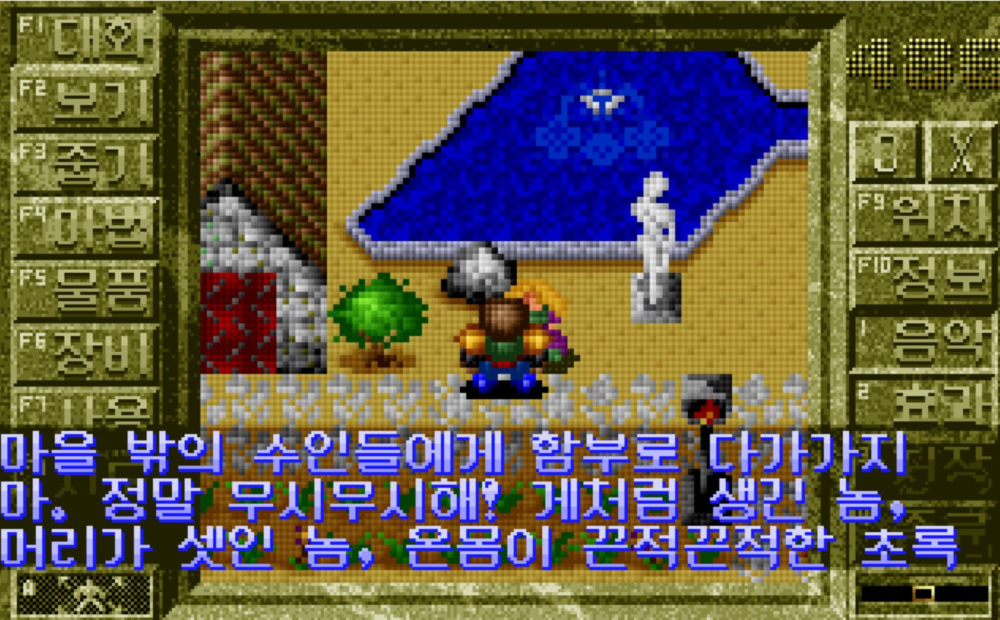
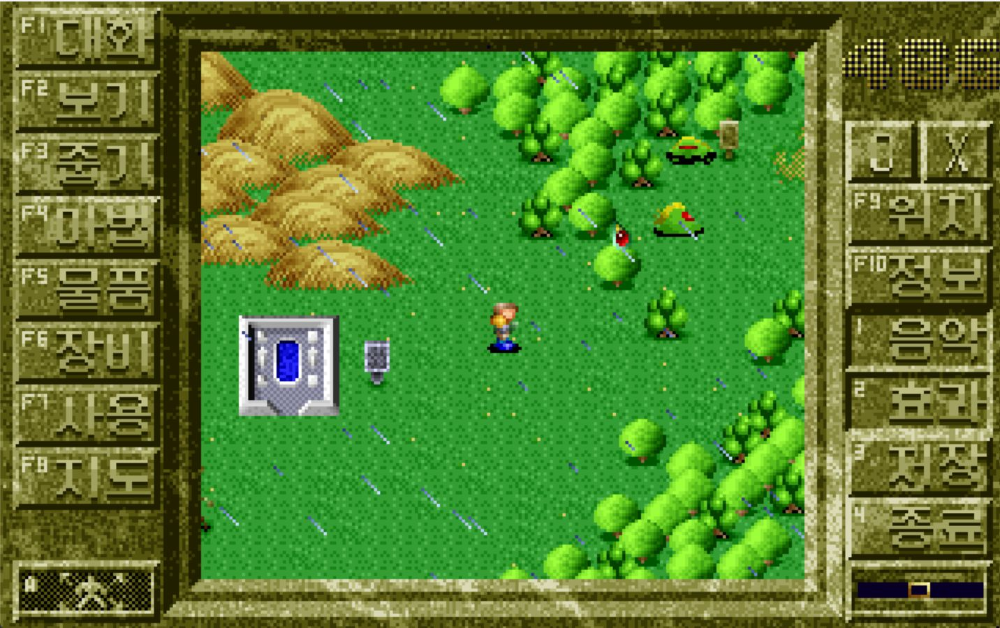

[English](README.md) | [中文](README.zh.md) | 한국어

# 3k-decomp

개인적인 리버스 엔지니어링 실험입니다. 1993년 대만의 第三波(Third Wave)가 펴낸 DOS 롤플레잉 게임
**三界諭：邦沛之謎**(삼계유: 방패지미, 작업 이름 "3K")의 코드를 C/C++ 소스로 재구성하여, 고치고 다시 컴파일하고
현대의 컴퓨터에서 실행할 수 있게 만드는 것이 목표입니다.

<p>
  
  
</p>

한국어로 플레이하는 화면(`--lang ko`): 첫 마을에서 마을 사람과 나누는 대화, 그리고 마을 밖의 월드 맵.

## 목표

1. **완전한 디컴파일.** 게임의 실행 로직 전체를 읽을 수 있고 빌드할 수 있는 **C 또는 C++** 소스로 되살립니다(언어 선택은
   원래 미정이었습니다. 아래 참조). "완전"이란 메인 루프만이 아니라 원본 실행 파일의 모든 코드 경로를 설명한다는 뜻입니다.
2. **수정과 재컴파일이 가능할 것.** 결과물은 일반적인 빌드 시스템과 현재의 도구(clang/gcc/MSVC)로 소스에서 빌드되며,
   16비트 DOS 컴파일러나 DOS 에뮬레이터가 필요 없습니다. 게임의 데이터, 표, 텍스트를 고칠 수 있을 만큼 이해합니다.
3. **현대 하드웨어에서 실행.** 재구성한 게임은 지금의 64비트 시스템에서 네이티브로 실행됩니다(먼저 Apple Silicon의 macOS,
   다른 플랫폼도 바람직함). 즉 1993년 PC에 묶인 모든 것을 바꿔야 합니다. DOS 인터럽트, VGA 비디오 메모리 직접 접근,
   옛 사운드 하드웨어, 키보드와 타이머 후킹, 16비트 `int`와 segment:offset 포인터, CPU 속도에 의존하는 타이밍입니다.
4. **충실한 동작.** 재구성한 게임은 원본과 똑같이 플레이되어야 합니다. 같은 규칙, 지도, 퍼즐, 전투, 줄거리, 그리고 가능한
   범위에서 세이브 파일 호환성까지 맞춥니다.

### 당장 하지 않는 것

- 원본 실행 파일과 바이트 단위로 같은 재현. 목표는 소스 수준의 동등함이지 같은 빌드 결과가 아닙니다.
- 원본 게임이나 그 리소스의 재배포([법률과 범위](#법률과-범위) 참조).
- 복사 방지, 라이선스 검사, 변조 방지 장치의 우회. 그런 것이 나오더라도 범위 밖입니다.
- 충실한 이식이 끝나기 전에 게임을 개선하는 일(새 기능, 밸런스 조정). (번역은 이식이 끝난 뒤에 했습니다. 영어와 한국어,
  `localization/`.)

## 대상

| 항목 | 내용 |
|------|------|
| 제목 | 三界諭：邦沛之謎 |
| 개발 / 발매 | 第三波(Third Wave), 카탈로그 번호 6G046 |
| 연도 | 1993(발매일은 1993-06-23으로도 기록됨) |
| 장르 | RPG, 3D 쿼터뷰, 실시간 사격과 파티 턴제 전투의 결합 |
| 언어 | 원본은 중국어(이식판에 영어와 한국어 추가, [빌드와 플레이](#빌드와-플레이) 참조) |
| 플랫폼 | DOS |
| 제작진(프로그래밍) | 李超群 |
| 참고 | [중국어 DOS 게임 데이터베이스, cdg-0202](https://cdosgame.simagame.me/games/cdg-0202/) |

데이터베이스 페이지에는 이 게임이 **CPU 속도에 민감해서 너무 빠른 기계에서는 멈출 수 있다**는 설명도 있습니다. 그래서 타이밍은
목표 3의 핵심 문제이지 마무리 작업이 아닙니다.

## 원본 자료

원본 파일은 모두 `original_bin/`에 있습니다(수정하지 않고 읽기 전용으로 다룹니다).

### 첫 조사에서 알게 된 것

방법: `original_bin/`의 파일에 대한 헤더 덤프(`xxd`), `file`, `strings`. 겉만 살펴본 것이며, 그때는 아직 아무것도 역어셈블하거나
실행하지 않았습니다.

| 파일 | 관찰 | 신뢰도 |
|------|------|--------|
| `3K.EXE`(3.3 MB) | 약 15 KB의 MZ 스텁, 오프셋 0x1C에 `RJSX` 표시, 그 뒤에 ARJ 압축 파일(ARJ 헤더 `60 EA`가 바이트 오프셋 약 15090에 있음). `file`은 ARJ 자동 압축 해제 파일로 보고합니다. 아마 설치 프로그램이고, 옆에 흩어진 파일들이 그것을 푼 내용일 것입니다. | "ARJ 자동 압축 해제"는 높음, 설치 프로그램이라는 역할은 추정 |
| `PLAY.BAT` | `cd\3k`, `mark`, `cd ..`. 그러므로 **`MARK.EXE`가 게임을 시작하는 입구**입니다. | 높음 |
| `MARK.EXE`(15 KB) | **PKLITE**로 압축됨(오프셋 0x1E에 `PKLITE Copr. 1990-91 PKWARE Inc.` 문구). 분석하기 전에 풀어야 하며, 그렇지 않으면 압축 해제 스텁만 보입니다. | 높음 |
| `TV.EXE`(8 KB) | 역시 PKLITE 압축. `CHKLIST.MS`에 `MARK.EXE`와 나란히 있음. 역할은 알 수 없고, 어쩌면 오프닝이나 타이틀 화면. | 압축은 높음, 역할은 모름 |
| `CHKLIST.MS` | `MARK.EXE`와 `TV.EXE`가 적힌 DOS 6 백신의 체크섬 목록. 설치된 게임의 실행 파일이 이 둘임을 확인해 줍니다. | 중간 |
| `*.LCZ`, `*.LCC`, `*.LCP`, `*.SL`, `*.ALL`, `SND_EF.1`, `TAB.TAB`, `_1_.LOC`, `__*.AL?`, `STORY*_V` | 독자 형식의 데이터 파일. 헤더가 아는 형식과 맞지 않고, 일부는 압축되거나 인코딩된 것 같습니다. 아마 그림, 애니메이션, 지도, 텍스트, 소리일 것입니다. | 형식 모름 |
| `SAVE*.000/.001/.002` | 세이브 파일, 슬롯마다 파일 세 개. 세이브 형식을 분석하기에 좋은 표본입니다. 일부는 날짜가 2000년대나 1980년이라 모두 원본은 아닐 수 있습니다. | 중간 |

### 열린 질문

- `MARK.EXE`는 압축 상태로 15 KB밖에 안 되어 RPG 엔진 하나로는 작습니다. 나머지 코드는 어디에 있을까요? 후보: 풀면 더 큰
  크기, `RPG.LCP`(120 KB) 같은 데이터 파일에서 읽어 들이는 코드 오버레이, 또는 또 하나의 단계 역할을 하는 `TV.EXE`.
  **아직 정해지지 않음.**
- 어떤 컴파일러와 메모리 모델로 빌드되었을까요? `3K.EXE`에 Borland 저작권 문구가 있지만, 아마 게임이 아니라 ARJ 자동 압축
  해제 스텁의 것입니다.
- 어떤 하드웨어를 직접 다룰까요(VGA 모드, Sound Blaster/AdLib/PC 스피커, 마우스)? 현대 플랫폼 계층을 설계하는 데 필요합니다.
- 게임은 중국어 텍스트와 글꼴을 어떻게 다룰까요? 디렉터리에 뚜렷한 글꼴 파일이 보이지 않았습니다. 상주형 중국어 시스템, 내장된
  글꼴 데이터, 또는 데이터 파일 안의 무언가를 쓸 수 있습니다.

## 진행 방식

각 단계가 확인할 수 있는 결과를 내도록 순서를 정했습니다.

1. **기준.** 에뮬레이터(DOSBox-X)에서 원본을 실행해 기준 동작을 기록합니다. 스크린샷, 세이브 파일, 타이밍. 이후 모든 단계를
   비교할 기준입니다.
2. **압축 해제와 지도 작성.** PKLITE로 압축된 실행 파일을 풀고, 실제 코드 진입점을 확인하고, 위의 열린 질문을 해결합니다.
3. **역어셈블과 디컴파일.** 푼 이미지를 REA 도구를 통해 Ghidra에 올립니다. 함수를 되살리고, C 런타임과 라이브러리 코드를 찾아내고,
   엔진 코드와 게임 로직을 나눕니다.
4. **형식 문서화.** 데이터 형식(`.LCZ`, `.LCC`, `.LCP`, `.SL`, `.ALL`, 세이브)을 분석합니다. 그것들을 읽고 다시 인코딩하는 작은
   독립 도구를 만들고, 원본 바이트로 왕복 변환을 검증합니다.
5. **C/C++로 로직 재구성.** 모듈 단위로 재구성하고, 이해가 깊어질수록 이름을 붙입니다. 추적할 수 있도록 원본 함수의 주소를
   주석에 남깁니다.
6. **플랫폼 계층.** DOS 전용 서비스(비디오, 입력, 소리, 타이밍, 파일 접근)를 이식 가능한 계층(아마 SDL2)으로 바꾸고, 타이밍을
   CPU 속도와 무관하게 만듭니다.
7. **검증과 반복.** 1단계의 기준과 비교해 차이를 고치고, 그다음에야 수정을 생각합니다.

## 완료의 정의

- 깨끗한 체크아웃에서 문서화된 명령 하나로, DOS 도구 없이 빌드됩니다.
- 빌드한 게임이 타이틀 화면에 도달하고, 새 게임으로 최소한 한 장의 줄거리를 끝까지 진행하며, 원본 세이브 파일을 불러오고,
  엔딩을 재생합니다.
- 원본 실행 파일의 모든 함수가 재구성되었거나, 의도적으로 대체했다고 명시되어 있습니다(예: DOS 인터럽트 처리기를 플랫폼 계층으로
  바꾼 것).
- 기록해 둔 시험 시나리오에서 동작이 원본과 같습니다. 같은 입력이 같은 게임 상태를 만듭니다.
- 데이터 형식 도구가 함께 배포된 모든 데이터 파일을 왕복 변환할 수 있습니다.

## 도구

- 역어셈블과 디컴파일에는 **REA MCP 서버**(`rea-agents`)와 **Ghidra 12.1.4**. Ghidra는 16비트 리얼 모드 지원이 약점이라
  segment:offset과 far 포인터 코드를 손으로 정리해야 하고, 옛 Borland/Microsoft/Watcom 라이브러리 함수도 자동으로 알아보지 못합니다.
- PKLITE 압축 해제 도구(선택 예정).
- 디버거와 기준 실행에는 **DOSBox-X**.
- 교차 확인용 대안(선택): Reko(DOS 지향 디컴파일러), IDA Free.

## 법률과 범위

"애반던웨어"는 커뮤니티의 용어이지 법적 지위가 아닙니다. 이 게임은 더 이상 팔리지 않지만, 저작권은 거의 확실히 아직
第三波 또는 그 승계자에게 있습니다. 이것은 개인적이고 교육적인 실험이며, 아래의 규칙으로 그렇게 유지합니다.

- **원본 게임 파일을 커밋하거나 재배포하지 않습니다.** `original_bin/`은 버전 관리와 이 저장소의 공개 사본에서 뺍니다. 결과물을
  빌드하는 사람은 누구든 게임 데이터를 직접 갖춰야 합니다.
- 독자적인 결과물만 공개합니다. 재구성한 소스, 도구, 메모. 그것도 공개하기 전에 검토해야 합니다. 저작권이 있는 프로그램에서
  디컴파일한 코드는 여전히 2차적 저작물일 수 있기 때문입니다.
- 복사 방지나 라이선스 검사를 우회하는 작업은 하지 않습니다.

## 저장소 구조

```
original_bin/   원본 게임 파일, 읽기 전용, 재배포 금지 (git에서 제외)
README.md       영어판 설명 (이 파일의 원문, README.zh.md는 중국어판)
docs/           연구 기록: 파일 형식, 코드 메모, 이식의 마일스톤 (docs/README.md부터)
src/            재구성한 게임, C99 (FM 칩용 C++ 파일 하나 포함)
tests/          단위 테스트, 창 없는 플랫폼, 검사용 덤프 프로그램
tools/          데이터 형식 도구, 기준이 되는 에뮬레이터 (dosemu.py), 검사와 변이 테스트 스크립트
localization/   영어와 한국어 번역, 그 원문 표와 글꼴 (localization/README.md)
third_party/    ymfm (OPL2 에뮬레이션)
work/           도구의 임시 출력 (git에서 제외)
```

## 빌드와 플레이

    make                                  # build/3k 빌드 (C99, ymfm에 C++14, sdl2-config로 SDL2)
    make test                             # 단위 테스트와 번역 검사
    build/3k --data original_bin --scene game

`--scene game`은 게임 전체를 실행합니다. 타이틀, 오프닝, 메뉴, 새 게임 또는 불러오기, 세계와 그 안의 전투, 엔딩까지입니다.
게임은 원본처럼 세이브와 상태 파일을 데이터 디렉터리에 씁니다. `original_bin/`의 사본으로 플레이하거나 `--write-dir DIR`을
주세요. 더 많은 옵션: `docs/port.md`의 "Build and run".

### 빌드 후 플레이하기

1. **저장소 루트에서 실행하세요.** `build/`에서 실행하면 안 됩니다. `--data`가 없으면 게임은 *현재* 디렉터리에서
   `original_bin/`을 찾기 때문에, `build/`에서 실행하거나 실행 파일을 더블클릭하면 데이터를 찾지 못하고 바로 종료됩니다.
   `--data DIR` 대신 `TK_DATA=DIR`을 써도 됩니다.
2. **`--scene game`을 주세요.** 없으면 프로그램은 `--scene title`, 즉 타이틀 화면만 실행합니다.
3. **원본 파일을 그대로 두려면** 세이브용 빈 디렉터리를 만들어 `--write-dir`로 지정하세요.

       mkdir -p saves
       build/3k --data original_bin --scene game --write-dir saves --lang ko

   Escape를 누르거나 창을 닫으면 종료됩니다.

**Windows (MinGW/MSYS2).** 실행 파일은 `build/3k.exe`입니다. 저장소 루트의 MSYS2 셸에서 위와 같은 인자로 실행하세요.
- `sdl2-config --libs`가 `-mwindows`로 링크하므로 프로그램에 콘솔이 없습니다. 시작하지 못할 때(예:
  `cannot read ... (data dir: original_bin)`) 메시지를 보여 주지 않고 종료합니다. 메시지를 보려면 출력을 파일로 보내세요.
  `build/3k.exe --data original_bin --scene game > log.txt 2>&1`을 실행한 뒤 `log.txt`를 읽으면 됩니다.
- 실행 파일에는 `SDL2.dll`과 `libstdc++-6.dll`이 필요합니다. MSYS2 셸은 `PATH`에서 찾지만, 탐색기에서 시작하려면
  두 파일을 MinGW의 `bin` 디렉터리(예: `C:\msys64\ucrt64\bin`)에서 `3k.exe` 옆으로 복사하고,
  "시작 위치"가 저장소 루트이며 위 인자를 붙인 바로 가기로 시작하세요.

**언어.** 기본은 중국어(원본)입니다. 영어나 한국어로 하려면 게임을 시작하는 디렉터리에 `3k.ini`를 두세요.

    [game]
    language=ko          ; zh, en 또는 ko
    localization=localization

`--lang zh|en|ko`가 이 설정을 덮어쓰고, `--config FILE`은 다른 파일을 읽습니다. 타이틀의 붓글씨 로고와 제작진 명단을 빼고
화면의 모든 것이 번역되어 있습니다. 음성 내레이션은 중국어(표준어) 그대로입니다. 번역을 저장하는 방식, 이름 규칙, 글꼴,
검사: `localization/README.md`.

## 현황

게임은 처음부터 끝까지 이식되었습니다(`docs/port.md`의 "Current state"). 원본의 모든 프로그램이 하나의 네이티브 프로그램 안에서
실행되며, 각 부분은 에뮬레이터(`tools/dosemu.py`)에서 돌린 원본 코드와 한 회차씩 비교되었습니다. 화면의 모든 텍스트에 대한
영어와 한국어 번역이 들어 있습니다(`localization/README.md`). 아직 하지 않은 것: 이식판으로 전체 줄거리를 한 번 끝까지 플레이하기,
그리고 Sound Blaster 효과음을 귀로 비교하기. 읽는 순서와 다음 단계는 `docs/README.md`에 있습니다.

## 제3자 코드

- `third_party/ymfm/`: Aaron Giles의 Yamaha FM 칩 에뮬레이션 [ymfm](https://github.com/aaronsgiles/ymfm), BSD 3-Clause
  (라이선스 문서는 그 디렉터리에 있음). OPL2 음악에 수정 없이 사용합니다. 고정한 커밋은 `third_party/ymfm/PINNED.txt`에 있습니다.
- `localization/fonts/tk_hangul16.tkf`: Eunbin Jeong의 [Neo둥근모](https://github.com/neodgm/neodgm)에서 변환한
  한글 비트맵, SIL Open Font License 1.1(라이선스 문서는 옆에 있음), OFL이 요구하는 대로 이름을 바꿈.
  `localization/fonts/tk_narrow6.tkf`: Markus Kuhn의 X11 misc-fixed 6x13 글꼴에서 가져옴, 퍼블릭 도메인.
  `localization/fonts/README.md` 참조.
