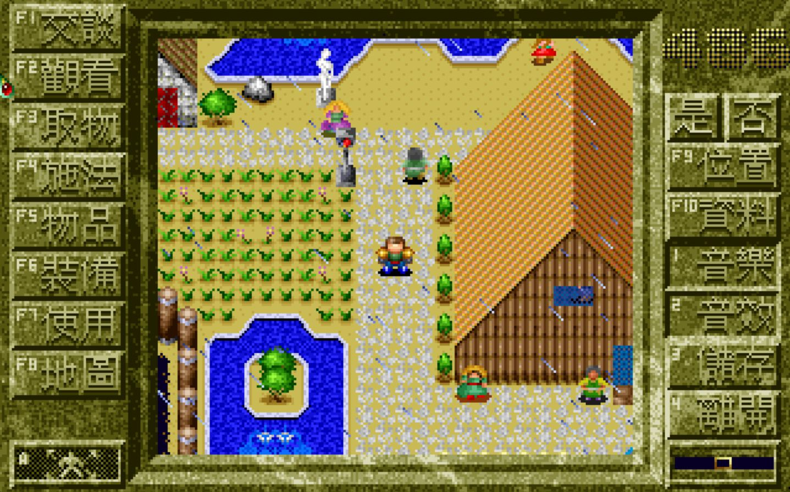
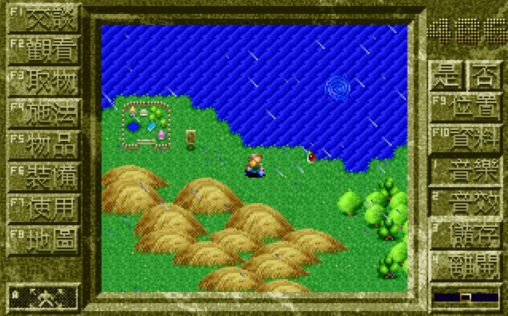

[English](README.md) | 中文 | [한국어](README.ko.md)

# 3k-decomp

這是一個個人的逆向工程實驗：把 1993 年台灣第三波（Third Wave）出版的 DOS 角色扮演遊戲
**三界諭：邦沛之謎**（工作名稱「3K」）的程式重建為 C/C++ 原始碼，讓它可以修改、重新編譯，並在現代電腦上執行。

## 目標

1. **完整的反編譯。** 以可讀、可建置的 **C 或 C++** 原始碼還原遊戲所有的執行邏輯（語言的選擇原本是待定事項，見下文）。
   「完整」指的是原版執行檔中的每一條程式路徑都有交代，而不只是主迴圈。
2. **可修改、可重新編譯。** 成果用一般的建置系統、以現行的工具鏈（clang/gcc/MSVC）從原始碼建置，不需要 16 位元 DOS
   編譯器或 DOS 模擬器。遊戲的資料、表格與文字都要理解到可以修改的程度。
3. **在現代硬體上執行。** 重建的遊戲直接在現在的 64 位元系統上執行（先是 Apple Silicon 的 macOS，其他平台也希望支援）。
   也就是要取代一切綁在 1993 年 PC 上的東西：DOS 中斷、直接存取 VGA 視訊記憶體、舊式音效硬體、鍵盤與計時器的攔截、
   16 位元的 `int` 與 segment:offset 指標，以及依賴 CPU 速度的計時。
4. **忠實的行為。** 重建的遊戲玩起來要和原版一樣：相同的規則、地圖、謎題、戰鬥、劇情，並在可行的範圍內與存檔相容。

### 目前不做的事

- 與原版執行檔逐位元組相同的重製。目標是原始碼層級的等價，而不是相同的建置結果。
- 散布原版遊戲或其資源（見[法律與範圍](#法律與範圍)）。
- 繞過任何防拷、授權檢查或防竄改機制。如果遇到，不在範圍內。
- 在忠實移植完成之前改進遊戲（新功能、平衡調整）。（翻譯是在移植完成之後才做的：英文與韓文，`localization/`。）

## 對象

| 項目 | 內容 |
|------|------|
| 名稱 | 三界諭：邦沛之謎 |
| 開發／發行 | 第三波（Third Wave），型錄編號 6G046 |
| 年份 | 1993（發售日也記為 1993-06-23） |
| 類型 | RPG，3D 斜角視點；即時射擊結合隊伍回合制戰鬥 |
| 語言 | 原版為中文（移植版另有英文與韓文，見[建置與遊玩](#建置與遊玩)） |
| 平台 | DOS |
| 製作人員（程式設計） | 李超群 |
| 參考 | [中文 DOS 遊戲資料庫，cdg-0202](https://cdosgame.simagame.me/games/cdg-0202/) |

資料庫頁面也提到，這款遊戲**對 CPU 速度很敏感，在太快的機器上可能當機**。因此計時是目標 3 的首要問題，而不是收尾的細節。

## 原始資料

所有原版檔案都放在 `original_bin/`（不修改，視為唯讀）。

### 第一次檢視的發現

方法：對 `original_bin/` 裡的檔案做檔頭傾印（`xxd`）、`file` 與 `strings`。這只是表面的檢視，當時還沒有反組譯或執行任何東西。

| 檔案 | 觀察 | 可信度 |
|------|------|--------|
| `3K.EXE`（3.3 MB） | 約 15 KB 的 MZ 引導程式，偏移 0x1C 有 `RJSX` 標記，後面接著一個 ARJ 壓縮檔（ARJ 檔頭 `60 EA` 約在位元組偏移 15090）。`file` 回報為 ARJ 自解壓縮檔。很可能是安裝程式，旁邊散放的檔案就是它解出來的內容。 | 「ARJ 自解壓縮」高；安裝程式的角色為推論 |
| `PLAY.BAT` | `cd\3k`，然後 `mark`，然後 `cd ..`。所以 **`MARK.EXE` 是啟動遊戲的入口**。 | 高 |
| `MARK.EXE`（15 KB） | 以 **PKLITE** 壓縮（偏移 0x1E 有 `PKLITE Copr. 1990-91 PKWARE Inc.` 字樣）。分析前必須先解壓，否則只看得到解壓縮的引導程式。 | 高 |
| `TV.EXE`（8 KB） | 同樣以 PKLITE 壓縮。在 `CHKLIST.MS` 裡和 `MARK.EXE` 並列。角色不明，也許是片頭或標題畫面。 | 壓縮高；角色不明 |
| `CHKLIST.MS` | DOS 6 防毒程式的檢查碼清單，列出 `MARK.EXE` 與 `TV.EXE`。確認這是安裝後遊戲的兩個執行檔。 | 中 |
| `*.LCZ`、`*.LCC`、`*.LCP`、`*.SL`、`*.ALL`、`SND_EF.1`、`TAB.TAB`、`_1_.LOC`、`__*.AL?`、`STORY*_V` | 專屬格式的資料檔。檔頭不符合我認得的任何格式，有些看起來經過壓縮或編碼。可能是圖像、動畫、地圖、文字與聲音。 | 格式不明 |
| `SAVE*.000/.001/.002` | 存檔，每個位置三個檔案。是逆向分析存檔格式的有用樣本。有些日期是 2000 年代或 1980 年，所以不一定全都是原版的。 | 中 |

### 待解的問題

- `MARK.EXE` 壓縮後只有 15 KB，對一整個 RPG 引擎來說很小。其餘的程式碼在哪裡？可能是：解壓後更大、從 `RPG.LCP`
  （120 KB）之類的資料檔載入的程式覆蓋段，或是由 `TV.EXE` 擔任另一個階段。**尚未確定。**
- 它是用什麼編譯器與記憶體模式建置的？`3K.EXE` 裡有 Borland 的版權字串，但那大概是 ARJ 自解壓縮的引導程式，不是遊戲本身。
- 它直接驅動哪些硬體（VGA 模式、Sound Blaster/AdLib/PC 喇叭、滑鼠）？設計現代平台層需要知道。
- 遊戲怎麼處理中文文字與字型？目錄裡沒有明顯的字型檔。可能用常駐的中文系統、內建的字型資料，或資料檔裡的某個東西。

## 做法

各階段的順序安排成每一階段都產出可以檢驗的東西。

1. **基準。** 在模擬器（DOSBox-X）裡執行原版，記錄參考行為：螢幕截圖、存檔與計時。這是之後每個階段比對的依據。
2. **解壓與對應。** 解開 PKLITE 壓縮的執行檔，確認真正的程式進入點，並解決上面的待解問題。
3. **反組譯與反編譯。** 透過 REA 工具把解壓後的映像載入 Ghidra。還原函式，辨識 C 執行期程式庫，並把引擎程式碼和遊戲邏輯分開。
4. **記錄格式。** 逆向分析資料格式（`.LCZ`、`.LCC`、`.LCP`、`.SL`、`.ALL`、存檔）。寫小型的獨立工具來解析並重新編碼，
   並以原始位元組驗證往返轉換。
5. **以 C/C++ 重建邏輯。** 逐個模組重建，隨著理解加深替東西命名。在註解中保留原版函式的位址以便追溯。
6. **平台層。** 以可攜的平台層（大概是 SDL2）取代 DOS 專屬的服務（視訊、輸入、音效、計時、檔案存取），並讓計時與 CPU 速度無關。
7. **驗證與迭代。** 與第 1 階段的基準比對，修正差異，之後才考慮修改。

## 完成的定義

- 專案能從乾淨的取出狀態，以一個有文件記載的指令建置，不需要 DOS 工具鏈。
- 建置出的遊戲能進入標題畫面，新遊戲至少能玩完一個完整的劇情章節，能載入原版存檔，並能播放結局。
- 原版執行檔中的每個函式要嘛已經重建，要嘛明確記錄為有意取代（例如把 DOS 中斷處理程式換成平台層）。
- 在一組記錄好的測試情境上，行為與原版一致：相同的輸入產生相同的遊戲狀態。
- 資料格式工具能對每個隨附的資料檔做往返轉換。

## 工具

- **REA MCP 伺服器**（`rea-agents`）搭配 **Ghidra 12.1.4** 做反組譯與反編譯。Ghidra 對 16 位元真實模式的支援是它的弱點，
  所以預期要手動整理 segment:offset 與遠指標的程式碼，也無法自動辨識舊的 Borland/Microsoft/Watcom 程式庫函式。
- 一個 PKLITE 解壓工具（待選）。
- **DOSBox-X**，用於除錯器與參考執行。
- 可選的交叉驗證工具：Reko（針對 DOS 的反編譯器）、IDA Free。

## 法律與範圍

「棄置軟體」（abandonware）是玩家社群的說法，不是法律上的地位。這款遊戲已經不再販售，但著作權幾乎可以確定仍屬於第三波或其繼承者。
這是一個個人的、教育性的實驗，以下規則讓它維持如此：

- **不要提交或散布原版遊戲檔案。** 讓 `original_bin/` 不進入版本控制，也不出現在本儲存庫的任何公開副本中。
  任何人要建置成果，都必須自備遊戲資料。
- 只公開原創的成果：重建的原始碼、工具與筆記。即使如此，公開分享前也應先檢視，因為從有著作權的程式反編譯而來的程式碼仍可能是衍生著作。
- 不做任何繞過防拷或授權檢查的工作。

## 儲存庫結構

```
original_bin/   原版遊戲檔案，唯讀，不可散布（git 忽略）
README.md       英文版說明（本檔案的原文；README.ko.md 為韓文版）
docs/           研究記錄：檔案格式、程式筆記、移植的里程碑（從 docs/README.md 開始）
src/            重建的遊戲，C99（另有一個 FM 晶片用的 C++ 檔案）
tests/          單元測試、無視窗的平台、供檢查用的傾印程式
tools/          資料格式工具、作為比對基準的模擬器（dosemu.py）、檢查與突變測試腳本
localization/   英文與韓文翻譯，以及它們的來源表與字型（localization/README.md）
third_party/    ymfm（OPL2 模擬）
work/           工具的暫存輸出（git 忽略）
```

## 建置與遊玩

    make                                  # 建置 build/3k（C99、ymfm 需要 C++14、透過 sdl2-config 使用 SDL2）
    make test                             # 單元測試與翻譯的檢查
    build/3k --data original_bin --scene game

`--scene game` 執行整個遊戲：標題、片頭、選單、新遊戲或讀取存檔、世界與其中的戰鬥、結局。
遊戲會像原版一樣，把存檔與狀態檔寫進資料目錄；請在 `original_bin/` 的副本上遊玩，或加上 `--write-dir DIR`。
更多選項：`docs/port.md` 的「Build and run」。

### 建置後如何遊玩

1. **從儲存庫的根目錄啟動**，而不是從 `build/`。沒有 `--data` 時，遊戲會在*目前*目錄中尋找 `original_bin/`，
   所以從 `build/` 執行（或直接雙擊執行檔）會找不到資料而立刻結束。也可以用 `TK_DATA=DIR` 代替 `--data DIR`。
2. **加上 `--scene game`。** 不加的話，程式執行的是 `--scene title`，只有標題畫面。
3. **讓原始檔案保持不變：** 建立一個空目錄存放存檔，並用 `--write-dir` 指定它：

       mkdir -p saves
       build/3k --data original_bin --scene game --write-dir saves

   按 Escape 或關閉視窗即可離開。

**Windows（MinGW/MSYS2）。** 執行檔是 `build/3k.exe`。請在儲存庫根目錄的 MSYS2 shell 中，用上面相同的參數執行。
- `sdl2-config --libs` 會加上 `-mwindows` 連結，所以程式沒有主控台：無法啟動時（例如
  `cannot read ... (data dir: original_bin)`），它會不顯示訊息就結束。要看到訊息，請把輸出導向檔案：
  `build/3k.exe --data original_bin --scene game > log.txt 2>&1`，再讀 `log.txt`。
- 執行檔需要 `SDL2.dll` 與 `libstdc++-6.dll`。MSYS2 shell 會在 `PATH` 上找到它們；若要從檔案總管啟動，
  請把這兩個檔案從 MinGW 的 `bin` 目錄（例如 `C:\msys64\ucrt64\bin`）複製到 `3k.exe` 旁邊，
  並用一個「開始位置」設為儲存庫根目錄、且加上上述參數的捷徑來啟動。

**語言。** 預設是中文（原版）。要玩英文或韓文版，在啟動遊戲的目錄放一個 `3k.ini`：

    [game]
    language=en          ; zh、en 或 ko
    localization=localization

`--lang zh|en|ko` 會覆蓋這個設定，`--config FILE` 則讀取另一個檔案。畫面上的一切都已翻譯，只有標題的書法字與製作群名單除外；
語音旁白仍是國語。翻譯的存放方式、命名規則、字型與檢查：`localization/README.md`。

## 畫面截圖

<p>
  
  
</p>

移植版的中文畫面（預設語言，與原版相同）：第一個村莊，以及村外的世界地圖。

## 狀態

遊戲已從頭到尾移植完成（`docs/port.md` 的「Current state」）：原版的每個程式都在同一個原生程式中執行，
而且每一部分都與在模擬器（`tools/dosemu.py`）中執行的原版程式碼逐回合比對過。所有畫面文字的英文與韓文翻譯都已內建
（`localization/README.md`）。尚未完成：在移植版中把整個劇情玩過一遍，以及用耳朵比對 Sound Blaster 的音效。
閱讀順序與下一步記在 `docs/README.md`。

## 第三方程式碼

- `third_party/ymfm/`：Aaron Giles 的 Yamaha FM 晶片模擬 [ymfm](https://github.com/aaronsgiles/ymfm)，BSD 3-Clause
  授權（授權文字在該目錄中），未經修改地用於 OPL2 音樂。固定的提交版本記在 `third_party/ymfm/PINNED.txt`。
- `localization/fonts/tk_hangul16.tkf`：由 Eunbin Jeong 的 [Neo Dunggeunmo](https://github.com/neodgm/neodgm)
  轉換而來的韓文點陣字，SIL Open Font License 1.1（授權文字在旁邊），依 OFL 的要求改名；
  `localization/fonts/tk_narrow6.tkf`：取自 Markus Kuhn 的 X11 misc-fixed 6x13 字型，公有領域。見 `localization/fonts/README.md`。
